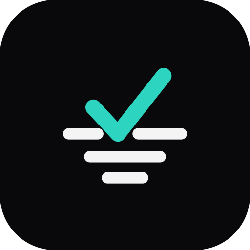

<p align="center">
  
</p>

<h1 align="center">Alva</h1>

<p align="center">Lembrou que acabou? Adicione. No mercado, é só marcar.</p>

O Alva é uma lista de compras compartilhada para uso doméstico. Feito para
adicionar produtos com pouca fricção e encontrar tudo com facilidade na hora
das compras, no celular ou no computador.

O app é self-hosted, sincroniza alterações em tempo real e pode ser instalado
como PWA pelo navegador. O uso atual é de uma única casa, com acesso restrito
pela rede local ou Tailscale e sem autenticação no aplicativo.

## Como funciona

- **Adicionar:** tela inicial focada no campo de produtos, posicionado na região
  central do celular para facilitar o alcance. Aceita vários nomes separados
  por vírgula, ponto e vírgula ou quebra de linha, até 30 por envio.
- **Lista:** produtos organizados por categoria e em ordem alfabética, com os
  pendentes antes dos comprados. Busca por parte do nome, sem diferenciar
  maiúsculas ou acentos, e filtro **Só pendentes**.
- **Iniciar compras:** transforma a Lista em um checklist com áreas de toque
  maiores e oculta os controles de edição. A busca e o filtro continuam
  disponíveis. Sair desse modo não altera os itens.
- **Categorização que aprende:** um dicionário classifica os produtos
  automaticamente. Corrigir uma categoria pelo lápis ensina o app para as
  próximas adições, sem IA ou serviços externos.
- **Comprar de novo e Habituais:** até cinco sugestões do histórico e um painel
  de produtos escolhidos pela casa para adicionar com poucos toques.
- **Compra feita:** arquiva os produtos marcados e mantém os pendentes na lista.
  Remoções e finalizações oferecem **Desfazer**.
- **Compartilhamento ao vivo:** alterações aparecem nos aparelhos conectados
  por Turbo Streams e ActionCable. A lista também pode ser exportada em PDF.
- **Personalização por aparelho:** temas claro e escuro, com destaque teal ou
  rosa, além da preferência de tela e do modo de compras. Uma pessoa pode usar
  rosa claro enquanto outra usa teal escuro na mesma lista.

O Alva mantém o foco em nomes de produtos: não há quantidades, modo offline,
login ou publicação na Play Store. O histórico arquivado alimenta as sugestões;
ainda não existe uma tela para consultá-lo.

## Stack

Ruby on Rails, SQLite, Hotwire (Turbo e Stimulus), ActionCable e Tailwind CSS.
Os testes usam Minitest e Capybara com navegador headless.

## Desenvolvimento local

Use a versão de Ruby indicada em [`.ruby-version`](.ruby-version), Bundler e
SQLite3. O processamento de imagens utiliza libvips; os testes de sistema
precisam de Chrome/Chromium ou navegador compatível.

```bash
bin/setup
```

O comando instala as dependências, prepara o banco e inicia o servidor e o
watcher do Tailwind. Acesse `http://localhost:3000`.

Para preparar o projeto sem iniciar o servidor, ou voltar a executá-lo depois:

```bash
bin/setup --skip-server
bin/dev
```

Comandos úteis:

```bash
bin/rails db:seed          # categorias e dicionário; preserva entradas aprendidas
bin/rails test             # testes de unidade e integração
bin/rails test:system      # testes de sistema (rodar após a suíte anterior)
bin/rubocop               # estilo Ruby
```

Se necessário, indique o binário do navegador nos testes de sistema:

```bash
CHROME_BIN=/caminho/do/navegador bin/rails test:system
```

## Acesso no celular e instalação

Para testar na rede local, compile o CSS e disponibilize o servidor nas
interfaces de rede:

```bash
bin/rails tailwindcss:build
bin/rails server -b 0.0.0.0
```

No celular conectado ao mesmo Wi-Fi, abra `http://<ip-do-servidor>:3000`.
Para acesso fora de casa, conecte o servidor e os celulares à rede Tailscale e
utilize o endereço do servidor nessa rede. O servidor deve permanecer ligado
e conectado.

Para instalar como PWA, use o endereço HTTPS do servidor e a opção **Instalar
app** ou **Adicionar à tela inicial** do navegador. O service worker requer
um contexto seguro (HTTPS ou localhost); acessar por IP via HTTP permite usar
a lista, mas não garante a instalação como PWA. Tailscale Serve é uma opção
para disponibilizar HTTPS dentro da rede Tailscale.

O service worker não fornece cache offline: o app precisa de conexão para
funcionar. Como não há autenticação, mantenha o acesso restrito à rede de
confiança; não exponha o app diretamente à internet pública.

## Hospedagem e dados

O projeto inclui [Dockerfile](Dockerfile) e uma configuração de referência
para [Kamal](config/deploy.yml). Ajuste os exemplos ao seu ambiente antes de
utilizá-los; eles não representam necessariamente a instalação em uso.

Em produção, preserve o diretório `storage/`, que contém os bancos SQLite,
entre atualizações e configure seu backup. O CI verifica testes, estilo,
análises de segurança, migrações, seeds e inicialização em produção.

## Documentação

- [Contexto do projeto e convenções](AGENTS.md)
- [Marca e arquivos dos ícones](docs/brand/README.md)
- [Paleta rosa clara e contrastes](docs/brand/pink-light.md)
- [Plano do modo de compras](docs/plans/shopping-mode.md)

O trabalho é acompanhado no [Linear, time ALV](https://linear.app/alva-isaac/team/ALV/all).
